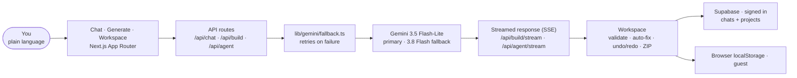

# ANVIX AI

**Turn ideas into working software.** Describe what you want in plain language, and ANVIX plans the architecture and generates the code — powered by Google's Gemini, with Fast / Smart / Deep chat modes (3.5 Flash-Lite, 3.8 Flash, GPT-OSS 120B reasoning via Groq when configured, else 3.8 Flash + Deep reasoning).

**Live demo:** https://anvix-ai.vercel.app/

---

## What it is

ANVIX AI is an applied-AI platform for building software with large language models. It gives you **one chat interface**, staged generation workflows, workspaces to organize projects, and a dashboard to track activity.

The core idea is **prompt engineering as the product**: natural-language intent goes in, structured model-directed prompts turn it into architecture plans and working code.

## Features

### 💬 Chat — Fast / Smart / Deep modes

Chat offers named modes instead of raw model ids (`lib/chat-modes.ts`): **Fast** (Gemini 3.5 Flash-Lite, fallback 3.8 Flash), **Smart** (3.8 Flash, fallback 3.5 Flash-Lite), and **Deep** (GPT-OSS 120B reasoning via Groq when `GROQ_API_KEY` is configured — Qwen 3.8 27B second — else 3.8 Flash with high thinking and a structured plan–solve–check reasoning prompt, fallback 3.5 Flash-Lite) — all on free tiers, each mode falling back to its second model if the first fails before answering. The thinking toggle maps onto Groq's `reasoning_effort` (Off→low, Fast→medium, Deep→high; both chain models support it per Groq's own reasoning docs). The Groq chain replaced the DeepSeek R1-distill on 2026-11-28 after Groq decommissioned it (HTTP 400 `model_decommissioned`, live) — model ids are checked against Groq's own deprecations page, never community lists. On the Gemini Deep path, Deep is agentic (`lib/chat/agentic-loop.ts`): it plans the question, runs up to 5 tool steps (live web search, Python code execution) on Flash-Lite, verifies the results, then streams the final answer with the verified brief as context — the plan/steps show live in the Thinking block, and any loop failure falls back to the plain Deep answer, never an error. The loop is skipped with attachments and does not run on the Groq leg (Groq stays one-shot). Web grounding is on by default (Google Search + URL Context, with a sources list under grounded answers; free tier: 5,000 searches/month) — note Groq has no grounding tools, so a Web-ON Deep request is answered by Groq ungrounded, and only falls back to a grounded Gemini answer if Groq fails. You can also attach up to 3 images (downscaled to ~768px in the browser) or PDFs (up to 3 MB) per message. The model registry (`lib/chat-models.ts`) keeps other providers visible but locked until their API keys and route wiring exist:

**Scaffolded in the UI** (visible but locked until their API keys are added):
- OpenAI: GPT-5.5, GPT-4.1, GPT-6 (Astra), GPT-4o
- DeepSeek Reasoner · xAI Grok / Grok Fast

Retired models are not offered: Gemini 2.5 Flash shut down 1 Dec 2026 (Google auto-routes it to 3.5 Flash-Lite), and Gemini 2.5 Flash-Lite and Gemini 2.0 Flash return 404 ("no longer available"). The build/agent chains fall back from 3.5 Flash-Lite to Gemini 3.8 Flash — both on the Gemini free tier.

Chat supports Markdown + GFM rendering and streaming responses (`/api/chat`, plain text by default or opt-in NDJSON events with `events: true`). Thinking text and sources are local display data — they persist in browser storage but are not synced to Supabase.

### 🛠️ Generation workflows

- **Generate** (`/generate`) — describe an app and watch its files arrive one by one over SSE (`/api/build/stream`), with the classic one-shot endpoint (`/api/build`) as a fallback. Every project passes deterministic validation (broken JSON, duplicate paths, missing imports); a one-pass auto-fix repairs what it can, and repairable JSON comma mistakes are fixed deterministically before the project ships.
- **Workspace agent** (`/api/agent`, `/api/agent/stream`) — ask for edits in plain language; the agent's plan is validated, applied to the project in the workspace, and can be undone/redone. Edits that fail validation are retried, and quota/availability failures surface as honest 503s instead of misleading errors.
- **Sandbox** (`/api/sandbox`) — sandboxed execution route. It honestly reports "not available in this environment" on hosted deployments (it needs local Docker) and is not reachable from the UI.

### 📁 Workspaces & dashboard

- **Workspaces** — edit generated code, ask the agent for changes (with undo/redo), and export the whole project as a ZIP file.
- **Dashboard** — cloud projects when signed in, local projects in guest mode.

### 🔐 Full app shell

Supabase authentication (email, Google, password reset) with per-user cloud sync for chats and generated projects — guest mode with browser-only storage when Supabase is not configured — plus per-user settings and a pricing page.

## How it works



`lib/gemini/fallback.ts` retries the model on retryable failures, falling back from 3.5 Flash-Lite to 3.8 Flash after both attempts on the primary fail.

## Tech stack

| Layer | Choice |
|---|---|
| Framework | Next.js 16 (App Router) · React 19 · TypeScript |
| Styling | Tailwind CSS v4 · shadcn/ui · Framer Motion · lucide-react |
| AI | `@google/generative-ai` (Gemini 3.5 Flash-Lite primary, 3.8 Flash fallback) |
| Data | Supabase (accounts + cloud sync) · browser localStorage (guest mode) |
| Tests | Node test runner (`node --test`) · `chat-models.test.ts` · `route.fallback.test.ts` |

## Getting started

```bash
npm install
npm run dev      # http://localhost:3000
npm run build    # production build
npm test         # node test suite
npm run lint     # eslint
```

Create `.env.local` before running. Verified variable:

```bash
# Google Generative AI key (required for chat + generation)
GEMINI_API_KEY=...

# Optional — enables accounts + cloud sync (without these, guest mode):
NEXT_PUBLIC_SUPABASE_URL=
NEXT_PUBLIC_SUPABASE_ANON_KEY=
```

Accounts are optional: to enable Supabase auth + cloud sync, add `NEXT_PUBLIC_SUPABASE_URL` and `NEXT_PUBLIC_SUPABASE_ANON_KEY` to `.env.local`, run `supabase/schema.sql` once in the Supabase SQL editor (profiles, conversations, messages, projects with row-level security), and add your deployment URL under Authentication → URL Configuration in the Supabase dashboard.

## Project structure

```
app/
├── api/
│   ├── agent/        # agent interactions (+ /stream for SSE streaming, returns the edited project)
│   ├── build/        # build pipeline (with fallback + tests)
│   ├── chat/         # chat completions
│   ├── generate/     # generation flows
│   └── sandbox/      # sandboxed execution
├── auth/             # authentication pages
├── chat/             # chat UI
├── dashboard/        # usage dashboard
├── generate/         # generation UI
├── pricing/          # pricing page
├── settings/         # per-user settings
└── workspace/        # workspaces
lib/
├── agent/            # agent logic (plan validation, edit tools, undo history)
├── api/              # API helpers
├── chat-models.ts    # model registry (live vs locked) + tests
├── chat-modes.ts     # Fast/Smart/Deep chat modes + thinking choices + tests
├── chat-attachments.ts # attachment validation (server) + tests
├── chat-events.ts    # NDJSON event protocol for /api/chat + tests
├── gemini/           # Gemini client, streaming generation, auto-fix
├── project/          # project domain logic (validation, JSON repair, ZIP export)
├── rate-limit.ts     # request rate limiting
├── sandbox/          # sandbox helpers
├── supabase/         # Supabase client + cloud sync (client.ts, cloud.ts)
└── utils.ts
components/           # shared UI (shadcn-based)
hooks/                # React hooks
```

## Roadmap

- [ ] Unlock OpenAI, DeepSeek, and xAI providers (UI already scaffolded — needs keys + route wiring). Note: Deep mode previously used a DeepSeek model — the R1-distill via Groq, wired in the groq-r1-deep lane (2026-11-27) — but Groq decommissioned it on 2025-10-02 and the chain was swapped to GPT-OSS 120B + Qwen 3.8 27B on 2026-11-28; the roadmap item is about the remaining scaffolded providers, not Deep reasoning.
- [ ] A second verified-live Gemini model in the chains (3.8 Flash and 3.5 Flash-Lite both answer live; Gemini 4-hydrogen was removed from the Deep chain on 2026-11-27 — it fails deterministically on this stack's legacy GenerateContent path and is only revisit-worthy after a migration to the `@google/genai` SDK)
- [ ] Runnable in-browser preview for generated projects (today the preview is a placeholder)
- [ ] Side-by-side multi-model comparison view
- [ ] Inspectable/editable prompt pipeline per generation stage
